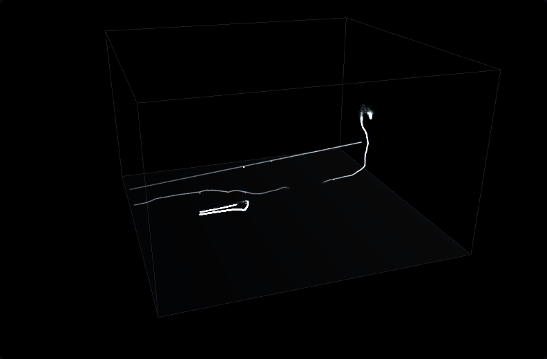

# cloud-chamber



A diffusion cloud chamber simulated from physics. Run it
in your browser: **[cloud-chamber-eight.vercel.app](https://cloud-chamber-eight.vercel.app)**. The same page is `public/index.html`, a single file you can open
locally.

Nothing in the code draws a track. Radiation crosses a gas, leaves ions, the ions seed droplets
where the alcohol vapor is supersaturated enough, and the droplets grow and fall. The picture is
those droplets. The idea comes from [rauchg/vinyl](https://github.com/rauchg/vinyl), which gets a
record player's sound from simulated groove geometry instead of audio effects. vinyl's tests print numbers and assert nothing. Here every
test asserts. Where a published reference exists (stopping powers, ranges, scattering, vapor
pressure, decay energies) the test compares against it. Where none does (the chamber's profiles,
the nucleation thresholds for isopropanol, how long a track lasts) the tests check conservation
laws and consistency, and the result is a model prediction, labelled as one below.

## Run it

```bash
bun install
bun run test           # physics, against NIST / PDG / HSDB reference values
bun run test:seeds     # the same suite with every seed shifted, eight times
bun run render         # headless WebGL2: measures rendered tracks against the same references
bun run demo           # rebuild the interactive page
bun run check-demo     # load the built page headless and use it
bun run report         # print the measured numbers quoted below
bun run typecheck && bun run lint
```

`bun run render` and `bun run check-demo` need Chromium:
`bunx playwright-core install chromium-headless-shell`. The committed page is byte-identical to a
rebuild only with Bun 1.3.14, the version CI pins.

## How it works

| Stage | File | What it computes |
|---|---|---|
| Chamber | `src/chamber.ts` | Steady temperature and vapor profiles between the cold plate and the warm, alcohol-soaked top. Supersaturation, the sensitive layer and the fog zone come out of this solve |
| Nucleation | `src/nucleation.ts` | When vapor condenses: on an ion (Thomson) or on its own (classical nucleation theory) |
| Transport | `src/transport.ts`, `src/stopping.ts`, `src/scattering.ts` | A particle's path through the gas: continuous energy loss, every elastic collision with a nucleus, every knock-on electron above 1 keV |
| Sources | `src/sources.ts` | Cosmic muons, radon alphas, gamma-ray electrons, and Am-241 and Sr-90 sources, with rates from stated physical quantities |
| Droplets | `src/engine.ts`, `src/droplet.ts` | Each ion that nucleates becomes a droplet that grows by vapor diffusion and falls |
| Picture | `src/render.ts` | Each droplet is one point; brightness is its cross-section times a forward-scattering phase function |

### What the model predicts

None of these is drawn or scripted; each follows from the stages above. None is compared with a
measurement of a real chamber. `bun run report` prints the numbers.

- **A sensitive layer.** With a 12 cm chamber, a -40 °C plate and a 20 °C top, ions seed
  droplets from 7 to 62 mm above the plate. Between 16 and 47 mm the vapor sits at the fog limit
  and makes a steady mist: 57% of the vapor leaving the top condenses before it reaches the plate.
- **The plate has to be cold, and the edge is soft.** With the top at 20 °C the layer disappears
  when the plate is warmer than -21.4 °C. A warmer top supplies more vapor and moves the limit
  up: -8.4 °C for a 35 °C top, and down to -29.9 °C for a 10 °C top. Tracks fade out over about two degrees: every ion of an alpha seeds a
  droplet over a -22 °C plate, 12% do at -21 °C, 0.04% at -20 °C, none at -18 °C.
- **Alphas stop sooner in cold gas.** A 5.5 MeV alpha's track is 3.57 cm long at 3 cm above the
  plate, against 4.14 cm in room-temperature air, because the gas there is denser.
- **Electron tracks curl.** Single collisions with nuclei turn a slow electron; a 100 keV
  electron travels 13.6 cm of path and ends much closer to where it started.
- **Tracks sink and vanish in a second or two.** Droplets on a muon track reach about 7 µm in
  0.3 s, and 90% of them have landed after 1.6 s. An alpha track's droplets are starved of vapor
  (2.3 µm at 0.3 s) and alone would take 25 s to land. The column is heavy enough to drag its
  air down with it, and with that downdraft 90% land in 1.1 s. The muon track is helped less:
  2.1 s without the downdraft. (Medians of five runs.)
- **Nuclear stopping.** A few keV of an alpha's energy goes to recoiling nuclei. It comes from
  the elastic collisions; there is no separate term for it.

## What is checked against what

| Quantity | Reference | Agreement asserted | Test |
|---|---|---|---|
| Electron collision stopping power, 10 keV to 100 MeV | NIST ESTAR | 0.1% to 3 MeV, 0.4% above | `stopping.test.ts` |
| Muon ionization loss, 10 MeV to 1 GeV; minimum 1.815 MeV cm²/g | PDG 2024 muon table for air | 0.3%; 0.2% | `stopping.test.ts` |
| Proton stopping power (Bethe cross-check) | NIST PSTAR | 1% from 10 MeV up; 1 to 2% high at 5 MeV, pinned (no shell corrections) | `stopping.test.ts` |
| Alpha range at 5.5 and 2 MeV | NIST ASTAR projected range | 1.5% (measured: 4.143 vs 4.161 cm, 1.036 vs 1.040 cm) | `transport.test.ts` |
| Electron path length at 100 and 20 keV | NIST ESTAR CSDA range | 3% | `transport.test.ts` |
| Multiple-scattering width | Highland formula (PDG) | 11%, the formula's own accuracy (measured: 11.81 vs 11.16 mrad) | `transport.test.ts` |
| Isopropanol vapor pressure | CRC table; HSDB | 8% from 2 to 82 °C; 3 to 4% at room temperature; 8 to 12% low at -26 °C, pinned | `thermo.test.ts` |
| Ion nucleation threshold for water | Wilson's 4.2 (textbook value, no source stored here) | Bracketed, not matched: the rate criterion the simulation uses gives 3.20 (24% low), Thomson's barrierless limit 4.26 | `nucleation.test.ts` |
| Beta mean energies, Sr-90 and Y-90 | IAEA/ENSDF: 195.7 and 932.4 keV | 3 to 6% high, pinned as a known bias (non-relativistic Fermi function) | `sources.test.ts` |
| Compton electron spectrum | Direct Klein-Nishina quadrature | 1% | `sources.test.ts` |
| Vapor and heat conservation in the chamber solve | The equations themselves | 1e-6 and 1e-4 | `chamber.test.ts` |
| Droplets sharing vapor along a track (engine) | Finite-difference solve of radial diffusion, in the test | 4% | `engine.test.ts` |
| A track's downdraft in slow viscous flow (engine) | Direct sum of the flow each droplet induces (Oseen tensor), in the test | 3% | `engine.test.ts` |
| The inertia-capped downdraft factor | Independent bisection of Lamb's equation, in the test | 1e-6 | `engine.test.ts` |
| The near-axis rotation bug stays fixed | The old rotation, kept in the test, is 20 to 40% below Highland | | `transport.test.ts` |
| **Rendered** alpha track length, top view | NIST ASTAR range in gas of the local density | 4% | `tools/render.ts` |
| **Rendered** muon track | Straight within 0.6 mm, wall to wall within 3% | | `tools/render.ts` |
| **Rendered** frame over a -15 °C plate (read after the ion lifetime), and with no radiation | Black | red, green and blue are 0 in every pixel (the canvas has no alpha) | `tools/render.ts` |

The reference tables are in `test/reference/`, each with its URL and fetch date. A "pinned"
tolerance is a known bias of the model, asserted from both sides so that neither a regression nor
a silent improvement passes unnoticed.

The two engine rows compare a closed-form shortcut with a brute-force numerical solution of the
same problem, and they drive the engine itself. They verify the shortcut, not the physics both
sides assume: a track core 0.1 mm in radius, heat spreading like vapor, and slow viscous flow in
unbounded gas with no plate underneath.

One of these checks found a real bug while the package was being written. The rotation that
applies each scattering angle discarded all accumulated deflection for directions within 4.5 mrad
of vertical, so steep tracks came out too straight. The scene looked fine. The Highland
comparison was a quarter low, and a test keeps the old rotation to show it still is.

## What is approximated, and what is left out

- **Slow alphas use a measured table.** A slow alpha keeps capturing and losing electrons, and
  no short formula gives its Bragg peak: Bethe is 21% high at 0.7 MeV. So alpha
  electronic stopping is NIST's ASTAR table (ICRU 49). The range test above then checks the
  transport, not the table.
- **Nucleation theory is classical, and the layer depends on it.** Thomson's and
  Becker-Döring's theories treat a cluster of tens of molecules as bulk liquid. For water the
  ion threshold used here is 24% below Wilson's measurement. For isopropanol at 243 K the ion
  threshold is 3.34 and the fog threshold 3.97: a window of 16%, narrower than that error. If
  the ion threshold were Thomson's barrierless limit (4.66) there would be no window and no
  tracks. That real isopropanol chambers work is the evidence for the ordering; the depth of the
  layer and the -21.4 °C limit are model results, and they move with the material constants:
  surface tension enters the barrier as its cube. No measured isopropanol threshold is compared.
  Positive and negative ions are treated alike.
- **One dimension, no convection.** The chamber solve assumes still, stably stratified gas (a
  test checks the stratification) and a top that is saturated at its own temperature. A real
  chamber with a poor vapor supply has a shallower layer than this one predicts.
- **Vapor pressure is extrapolated.** Below 298 K the enthalpy fit is outside its fitted range;
  the model is 10% low at -26 °C, the coldest reference point, and unchecked below that.
- **Vapor diffusivity** is the Fuller correlation and is not compared with a measurement.
- **Super-droplets.** An alpha makes about 315,000 droplets; each array entry stands for about
  15 of them. Muon and electron tracks are close to one entry per droplet.
- **Droplets on a track** share vapor through a quasi-steady line-sink formula, and the track
  sinks as a column. In slow viscous flow the downdraft would be (f / 4πη)(ln(L/R) + 0.45) for
  weight per length f; the 0.45 is recomputed by a test. Inertia limits how much air a track
  can drag, and Lamb's formula for a cylinder sets the downdraft for nearly every track here;
  the viscous law applies only to very light columns. Lamb's formula is for Reynolds numbers
  well below 1. The typical droplet on a track sinks at a Reynolds number near 0.5 (on the
  track diameter), and the densest part of an alpha column goes higher, so the formula is used
  at the edge of its range. It is taken from the literature and not checked numerically here.
  The track core radius is an assumed 0.1 mm, which enters only through logarithms. The plate
  under the track is ignored, and a knock-on electron's droplets are given the length of the
  track it came from. Track lifetimes rest on these terms and are not compared with a
  measurement.
- **The threshold is one nucleation per ion per second**, with ions lost after 1 s. Both are
  conventions. The rate rises so steeply with supersaturation that a hundredfold change in the
  convention moves the plate limit by about a degree.
- **Left out:** bremsstrahlung, the spin correction to electron scattering, the alcohol vapor's
  share of the stopping power, electrons entering from the walls, ion recombination, a clearing
  field, and droplets heating the gas around a track enough to make it rise.
- **Light.** Scattering uses a Henyey-Greenstein phase function with g = 0.85, not Mie theory.
  On screen a track is as wide as the point sprite (0.9 mm in the gate's top view), not as wide
  as the droplets are spread (a median of 25 µm from the line for a muon). An alpha track looks
  thick because it is bright.
- **Rates.** The muon spectrum is a rough log-normal (all values are near minimum ionization).
  Background gammas all have the K-40 line energy. Radon is 40 Bq/m³ with 40% of daughters
  airborne; the gamma dose rate is 60 nGy/h. These four are typical values, not measurements.

## Sources

- NIST ASTAR, PSTAR and ESTAR stopping-power and range tables for dry air.
- Particle Data Group 2024: atomic and nuclear properties of air; muon energy-loss table;
  "Passage of particles through matter" (Bethe equation, delta rays, Highland formula).
- ICRU Report 37 (electron stopping powers), Report 49 (protons and alphas), Report 31 (W values).
- IAEA Live Chart of Nuclides (ENSDF): beta end points and mean energies of Sr-90 and Y-90.
- Lamb, Phil. Mag. 21 (1911) 112: drag on a cylinder at small Reynolds number.
- NIST Chemistry WebBook, isopropanol (C67630): boiling point, enthalpy of vaporization.
- PubChem CID 3776 (HSDB): surface tension, density and vapor pressure of isopropanol.
- Fuller, Schettler and Giddings, Ind. Eng. Chem. 58 (1966) 18: gas diffusion coefficients.
- Langsdorf, Rev. Sci. Instrum. 10 (1939) 91: the diffusion cloud chamber.
- Mason, The Physics of Clouds: droplet growth by diffusion.

## Contributing and license

See [CONTRIBUTING.md](CONTRIBUTING.md). Code is MIT ([LICENSE](LICENSE)). The reference values under
`test/reference/` and the ASTAR table in `src/data/` are published factual data from the sources
above, kept here so the tests can run offline.
